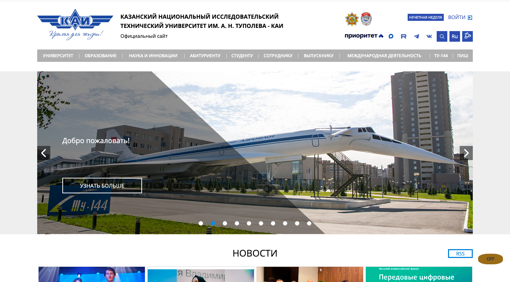
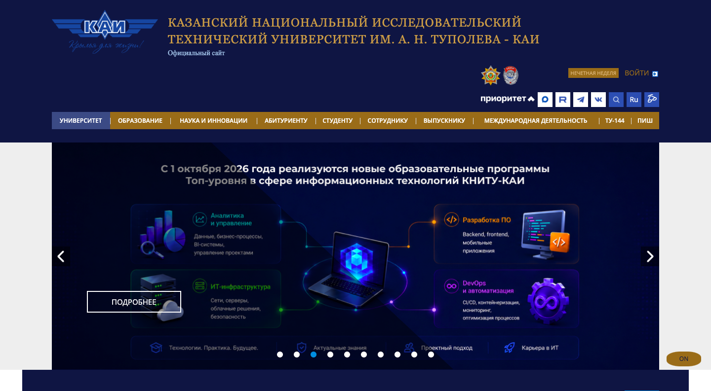
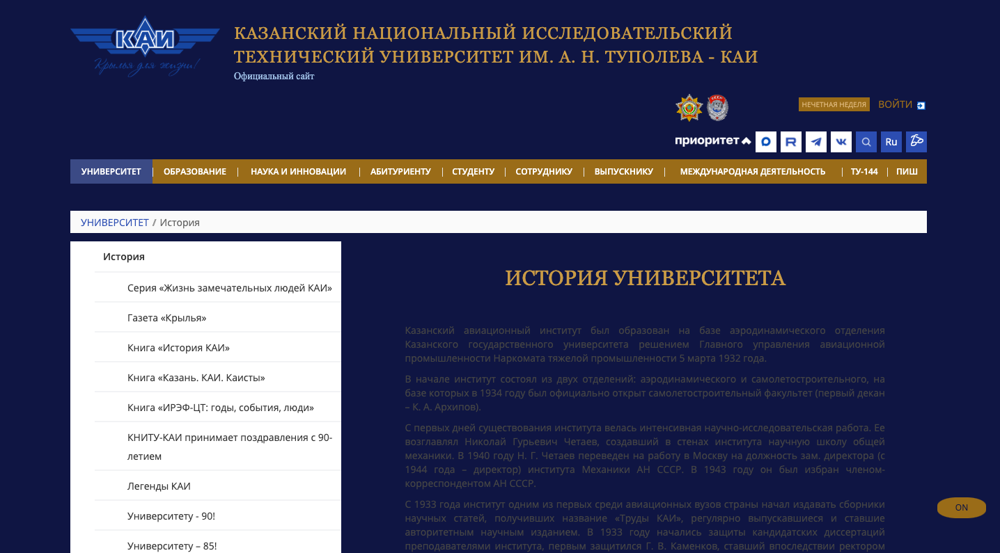
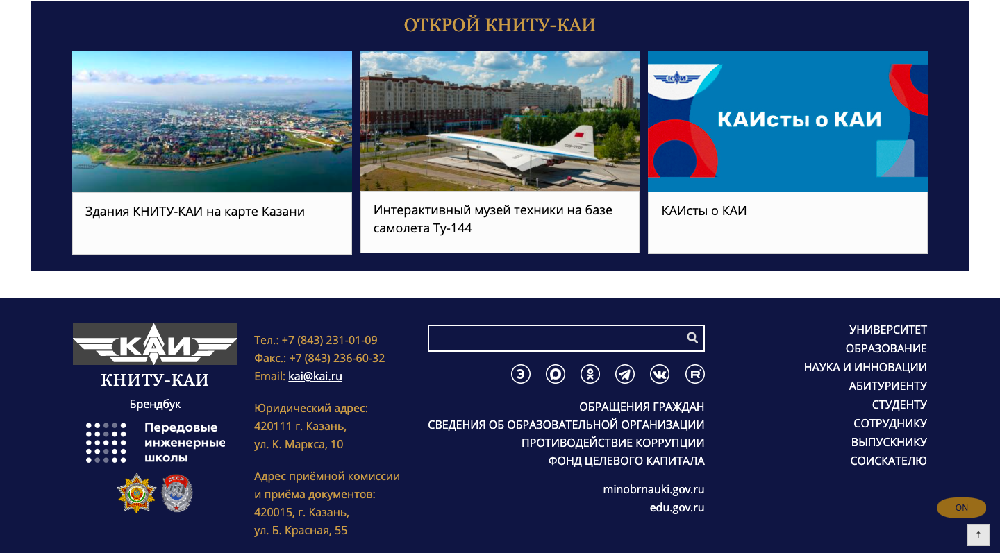

# KAI Ravenclaw Style

Расширение для Google Chrome и Яндекс Браузера, которое меняет оформление сайта [kai.ru](https://kai.ru) в стиле факультета Когтевран («Лазурь и бронза»).

## Описание

На сайте появляется кнопка-переключатель в правом нижнем углу окна. Кнопка закреплена и остаётся на месте при прокрутке, поэтому тему можно выключить с любого места страницы. По нажатию страница меняет стиль, а кнопка показывает текущий статус: **ON** (включено) или **OFF** (выключено). Выбор сохраняется в `localStorage`, поэтому после перезагрузки и при переходе на другие страницы сайта тема остаётся такой, какой её оставил пользователь.

### Палитра варианта

| Цвет | Где используется |
|------|------------------|
| `#0e1a40` (тёмно-синий) | фон страницы и блоков |
| `#3b4e81` (акцентный синий) | первый пункт меню, элементы оформления |
| `#946b2d` (бронза) | пункты меню, блок недели, кнопка |

Заголовки и название вуза оформлены золотистым цветом шрифтом с засечками, чтобы они читались на тёмном фоне.

## Что меняется на странице

- фон страницы, основного блока, секций и подвала;
- цвет, шрифт и размер названия вуза и заголовков;
- цвет и фон пунктов верхнего меню, отдельный цвет первого пункта;
- цвет и фон блока чётной/нечётной недели;
- цвет ссылки «Войти»;
- цвет логотипа «Приоритет» (через `filter`);
- цвет текста в подвале.

Стили включаются классом `ravenclaw-on` на теге `body`. Весь внешний вид описан в `style.css`, а JavaScript только добавляет и убирает классы.

## Использованные методы DOM

- `getElementById`: поиск кнопки и элемента `weekParity`;
- `querySelector`: поиск контейнера `.cf.user_links` (сложный селектор из двух классов) и списка `.menu-list`;
- `querySelectorAll`: выбор всех пунктов меню по селектору `.menu-list > li` и обход через `forEach`;
- `parentElement`: получение блока недели от элемента `weekParity`;
- `children`: выбор первого пункта меню.

## Структура проекта

```
style-plugin/
├── manifest.json   # описание расширения (Manifest V3)
├── content.js      # создание кнопки, переключение, сохранение состояния
├── style.css       # стили темы
├── readme.md
└── images/         # скриншоты
```

## Установка и запуск

1. Скачайте или склонируйте репозиторий и найдите папку с плагином (`manifest.json` должен лежать прямо в ней).
2. Откройте страницу расширений: `chrome://extensions` в Chrome или `browser://extensions` в Яндекс Браузере.
3. Включите **«Режим разработчика»**.
4. Нажмите **«Загрузить распакованное расширение»** и выберите папку с плагином.
5. Откройте [https://kai.ru](https://kai.ru). В правом нижнем углу появится кнопка. Нажмите на неё, чтобы включить или выключить тему.

После изменения файлов плагина нажмите кнопку обновления на карточке расширения и перезагрузите страницу.

## Примеры работы

**Тема выключена (OFF)**



**Тема включена на главной странице (ON)**



**Тема включена на странице «История»**



**Подвал страницы**



## Ограничения

Плагин работает на адресах `https://kai.ru/*`. На поддоменах (например, `priority2030.kai.ru`) он не подключается.